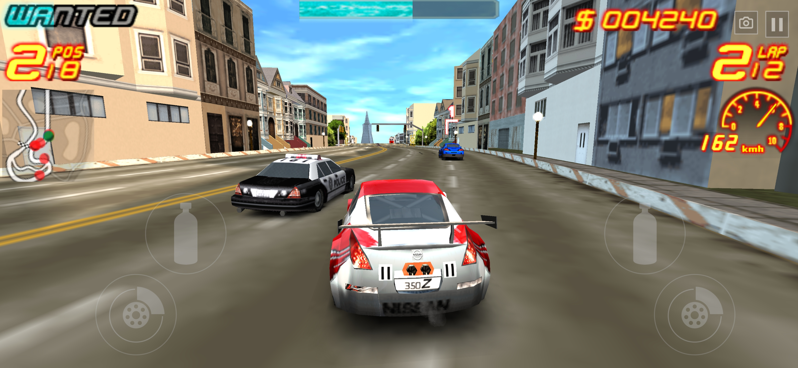
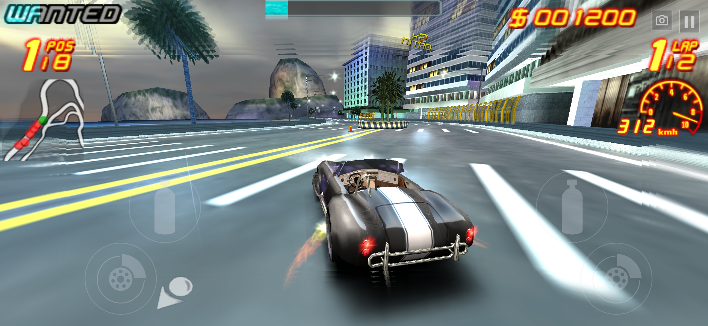
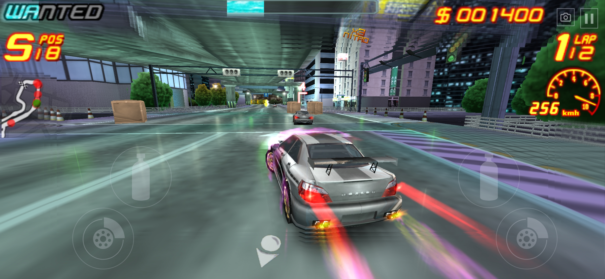
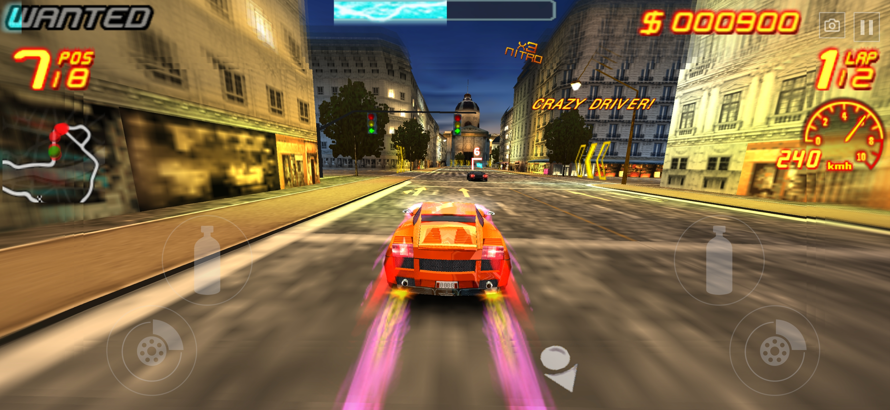
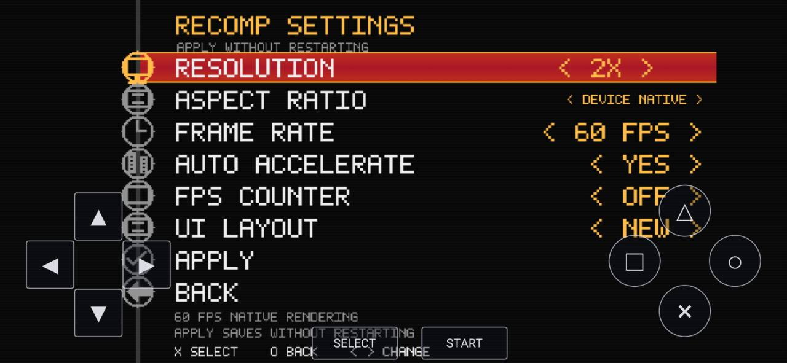

# Asphalt Urban GT 2

## Current release: 1.0

**Race on Windows and Android.** An unofficial native recompilation of the
European PSP version of Asphalt Urban GT 2, with higher rendering resolutions,
30/60 FPS options, widescreen support, and controls for each platform.

You need your own original **European PSP ISO (ULES00719)** to play.
The game ISO is not included. You do not need to compile the source or install a
separate PSP emulator to use the release builds.

## Downloads

**[Get the latest release](https://github.com/samsixx6/Asphalt-Urban-GT-2-Recomp/releases/latest)**

Choose the file for your device from the release's **Assets** section:

| Your device | Download for version 1.0 | What to do with it |
|---|---|---|
| Windows PC, x64 | [Windows ZIP](https://github.com/samsixx6/Asphalt-Urban-GT-2-Recomp/releases/download/1.0/Asphalt-Urban-GT-2-v1.0-windows-x64.zip) | Extract the whole ZIP, then open `Asphalt2.exe`. |
| Android phone or tablet, ARM64 | [Android APK](https://github.com/samsixx6/Asphalt-Urban-GT-2-Recomp/releases/download/1.0/Asphalt-Urban-GT-2-v1.0-arm64.apk) | Install the APK, then open **Asphalt Urban GT 2**. |

The **Source code** ZIP and TAR.GZ downloads are for developers. To launch the
game, use the Windows ZIP or Android APK above.

## Community

Join the Discord community for news, updates, and support.

- [Join Discord](https://discord.gg/cVHYSwn9Bq)
- [Report a problem on GitHub](https://github.com/samsixx6/Asphalt-Urban-GT-2-Recomp/issues)

## Screenshots

<table>
  <tr>
    <td align="center"></td>
    <td align="center"></td>
  </tr>
  <tr>
    <td align="center"></td>
    <td align="center"></td>
  </tr>
</table>

## Features

- Native builds for **Windows x64** and **Android ARM64**.
- Rendering resolutions from **1x to 6x**, **30/60 FPS** options, and
  **Device Native** or original **PSP** aspect ratios.
- Windows keyboard and XInput controller support, plus Android touchscreen
  steering with dedicated NOS, brake, pause, and camera controls.
- **Original** and **New** HUD layouts, optional Auto Accelerate, and an
  optional FPS counter.
- In-game **Recomp Settings** with **Apply** to save changes without restarting.
- Remembered ISO selection and persistent saves and settings.

[Requirements](#requirements) · [Windows setup](#windows-setup) ·
[Android setup](#android-setup) · [Recomp Settings](#recomp-settings) ·
[Windows controls](#windows-controls) · [Saves and updates](#saves-and-updates) ·
[Troubleshooting](#troubleshooting) · [Screenshots](#screenshots)

## Requirements

| Platform | Required |
|---|---|
| Windows | Windows 10 version 1903 or newer, or Windows 11; x64; a graphics driver supporting **OpenGL 3.3**; an available audio output. |
| Android | **Android 8.0 or newer**, a **64-bit ARM64 Android installation**, and **OpenGL ES 3.0** support. |
| Both | Your own supported **ULES00719 Europe ISO**, stored on the device and kept available when you play. |

These are compatibility requirements. Performance depends on your hardware,
track, and settings; selecting 60 FPS does not guarantee every device can reach it.

Only the supported original ISO is accepted. Other regions, modified images,
and compressed CSO files are not supported by these releases.

<details>
<summary>Check the supported ISO's size and SHA-256</summary>

The supported ISO is **884,146,176 bytes**. Its SHA-256 is:

```text
64ab1ba788baade948b9b89d47145a653c063e85afed403b89d917d8a8703ec4
```

Renaming another file to match the game name does not change its contents.

</details>

## Windows setup

1. Download the **Windows ZIP** from [Releases](https://github.com/samsixx6/Asphalt-Urban-GT-2-Recomp/releases/latest).
2. Right-click the ZIP and choose **Extract All**. Keep all extracted files
   together, including the DLL files beside `Asphalt2.exe`.
3. Open **`Asphalt2.exe`** from the extracted folder.
4. When the file picker opens, select your supported original **`.iso`** file.
   Let the game verify it and finish loading.
5. Use the keyboard or an XInput-compatible controller to play. At the title
   screen, **Enter** acts as START; in menus, **Space** selects an item.

The game remembers your ISO's location. On later launches, open `Asphalt2.exe`
again. If the ISO was moved or deleted, you will be asked to select it again.

## Android setup

1. Copy your supported original **`.iso`** to a folder on the phone that you
   plan to keep, such as a Games folder in internal storage.
2. Download and open the **Android APK**. If Android asks, allow your browser or
   Files app to **install unknown apps**, then finish installing it.
3. Open **Asphalt Urban GT 2** and tap **Choose ISO**. Select the ISO with
   Android's file picker and wait for verification to finish.
4. Tap **Play**. Allow the storage access requested by the app. On Android 11
   and newer, this uses the system's **All files access** settings screen;
   enable access for this app and return to it.
5. The app creates **Internal storage/asphalt2recomp/data** automatically.
   You do not need to choose or create a data folder yourself.
6. At the title screen, tap **START**. Use the on-screen D-pad and **X** button
   to navigate menus and select items.

If you decline storage access, the game stays in the launcher. Tap **Play**
again when you are ready to grant access.

After the ISO and storage access are set up, later launches go straight into the
game while the ISO remains accessible. You can minimize the app and return to
the current session; Android may still end background apps when it needs memory.

## Recomp Settings

From the game's **Options** menu, select **Recomp Settings**, above **Back**.
Move up or down to choose a setting and left or right to change it, then select
**Apply** to save and apply your changes without closing the game.

<p align="center">
  
</p>

| Setting | What it changes |
|---|---|
| Resolution | Rendering scale from **1x to 6x**. Higher values produce a sharper picture and require more GPU work. |
| Aspect Ratio | **PSP** keeps the original screen shape; **Device Native** uses your display's aspect ratio. |
| Frame Rate | Choose **30 FPS** or **60 FPS**. |
| Auto Accelerate | Accelerates for you when enabled. |
| FPS Counter | Shows or hides the frame-rate counter. It is **off by default**. |
| UI Layout | Choose **Original** or **New** HUD placement. |

Fresh installations start with these settings; existing saved choices are kept:

| Platform | Starting settings |
|---|---|
| Windows | 4x resolution · Device Native · 60 FPS · Auto Accelerate Off · FPS Counter Off · Original UI |
| Android | 2x resolution · Device Native · 60 FPS · Auto Accelerate On · FPS Counter Off · New UI |

If performance is uneven, try a lower resolution scale or the 30 FPS option.

## Windows controls

| Action | Key |
|---|---|
| Accelerate | **W** or **Up arrow** |
| Brake | **S** or **Down arrow** |
| Steer left / right | **A / D** or **Left / Right arrows** |
| Use NOS | **Space** |
| Pause / START | **Enter** |
| Change driving camera / SELECT | **Backspace** |
| Navigate menus | **Arrow keys** or **WASD** |
| Select a menu item / PSP X | **Space** or **X** |
| Back in menus / PSP Circle | **C** |
| Toggle fullscreen | **F11** |
| Close the game | **Esc** or the window's close button |

**Space changes with the screen:** it selects items in menus and uses NOS
during a race. XInput-compatible controllers are also supported on Windows.

## Saves and updates

Choose **YES** when the original game asks whether to allow autosaves.
The game's references to a Memory Stick are part of its original PSP interface.

| Platform | Save and settings location |
|---|---|
| Windows | `%LOCALAPPDATA%\Asphalt2Recomp` — paste this into File Explorer's address bar. |
| Android | **Internal storage/asphalt2recomp/data** (`/storage/emulated/0/asphalt2recomp/data`). |

Close the game before copying either folder to make a backup. Your ISO is
separate from these folders and must remain available to launch the game.

For a Windows update, extract the new release and launch its `Asphalt2.exe`;
your data stays in Local AppData. For Android, install the new APK from this
project's Releases as an update over the existing app and keep your data folder.

## Troubleshooting

| Problem | What to check |
|---|---|
| Which file do I download? | The **Windows x64 ZIP** for a PC or **ARM64 APK** for Android. Source-code archives are for building the project. |
| My ISO is rejected | Check that it is the original **Europe ULES00719** ISO. Compare its size/hash in [Requirements](#requirements). |
| I am asked to choose the ISO again | Check whether it was moved, renamed, deleted, or is no longer accessible to the app. |
| Android Play does not launch the game | Grant the requested storage access. If it was declined, tap **Play** again and allow it. |
| Android says the APK is incompatible | Check for Android 8.0+ and a **64-bit ARM64 operating system**; a 64-bit CPU alone is not enough. |
| Windows reports a missing DLL | Extract the **entire** Windows ZIP and keep its DLLs beside `Asphalt2.exe`. |
| Windows cannot start the graphics or audio device | Check for an OpenGL 3.3-capable graphics driver and an available audio output. |
| The Android car does not accelerate | Keep **Auto Accelerate → On** when using the race touch layout. |
| Windows keys do not respond | Click the game window to give it keyboard focus. |
| Motion is uneven | Try a lower resolution or 30 FPS. When reporting it, include the track and whether the FPS counter matches what you see. |
| I see the autosave question at startup | Choose **YES**. The prompt alone does not show that progress was lost; check whether your actual saved progress loads. |

Still having trouble? [Open an issue](https://github.com/samsixx6/Asphalt-Urban-GT-2-Recomp/issues/new)
with your app version, device/Windows version, track and game mode, car, Recomp
Settings, and steps to reproduce it. A screenshot or short video helps with
visual problems. Android's launcher includes **Save Performance Report**;
Windows logs are in `%LOCALAPPDATA%\Asphalt2Recomp\logs\session.log`.

## About the project

The original game program is statically recompiled into native code, with a
custom runtime providing the PSP services and graphics support it needs.
Windows and Android share that core, with separate desktop and mobile hosts.

To build either platform yourself, start with the [build guide](docs/building.md).
Additional Windows information is in [the Windows guide](docs/windows.md).
You will need the supported original ISO to prepare a local game build.
GitHub's source checks run without uploading a game ISO.

### Credits and notices

- Project maintained by [SamTheDev / samsixx6](https://github.com/samsixx6).
- Recompiler/runtime based on [psprecomp](https://github.com/sp00nznet/psprecomp),
  pinned to `0ad357fed8fd4a59226034ff6e61aaba2a0d27bb` with local changes.
- Adapted PSP service code credits:
  [PateeerQ/FreedomUniteRecomp](https://github.com/PateeerQ/FreedomUniteRecomp).
- Audio/video support uses [FFmpeg](https://ffmpeg.org/).
- See [source and dependency notices](docs/source-license.md),
  [third-party notices](THIRD_PARTY_LICENSES.txt), and the
  [psprecomp license](vendor/psprecomp/LICENSE).

This is an unofficial fan project. Rights in the original game, trademarks,
and depicted game artwork remain with their respective owners.
